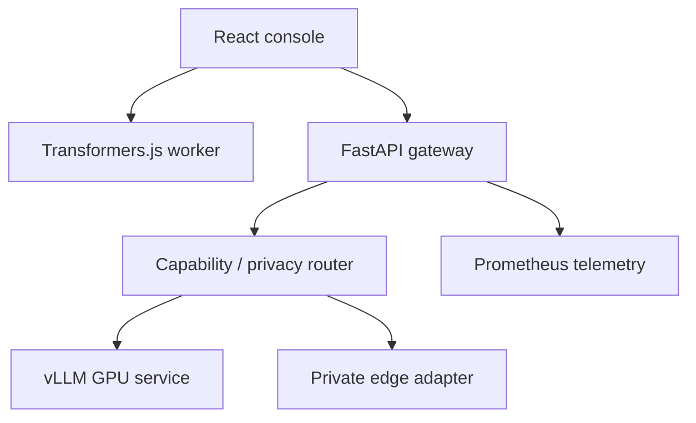

# Open WebGPU Inference Engine

**CodesbyFebin · Open inference infrastructure for browser, edge, and GPU.**

[](https://github.com/CodesbyFebin/Open-WebLLM-inference-engine/actions/workflows/ci.yml)
[](https://github.com/CodesbyFebin/Open-WebLLM-inference-engine/actions/workflows/postgres-qualification.yml)
[](https://github.com/CodesbyFebin/Open-WebLLM-inference-engine/actions/workflows/nvidia-nim-qualification.yml)

> **Verification status:** automated CI verifies the API, browser build, PostgreSQL security and recovery fixtures, and container worker lifecycle. A bounded NVIDIA NIM free-tier smoke run has passed. This is not a claim of full production verification: physical-device inference, production deployment operations, and independent security assessment are still pending. See the [evidence register](docs/PRODUCTION-GATES.md).

This repository begins with a working-source foundation: React/TypeScript WebGPU inference console, FastAPI gateway, authenticated routing and vLLM deployment manifests. Runtime integrations have individually declared states, and unfinished adapters are not advertised as runnable.

## Studied techniques

`docs/upstream-skills/TECHNIQUES.md` merges notes from browser WebGPU, worker, and on-device model repositories. The notes are not vendored runtimes. WebLLM remains a planned separate adapter. Unlicensed upstream trees were not copied.

## Runtime support matrix

| Runtime | Use | State |
| --- | --- | --- |
| Transformers.js | ONNX q4f16 browser text generation | Implemented source; device validation pending |
| vLLM | GPU text generation | Configured; NVIDIA runtime validation pending |
| Local OpenAI-compatible server | Private edge node | Registry/routing capability; inference adapter pending |
| WebLLM | Browser MLC models | Planned separate adapter |
| ComfyUI | Image graph workflows | Planned workflow adapter |
| MNN / Cactus | Native mobile | Planned SDK bindings |

## Evidence-gated benchmarks

The gateway implements a real streaming benchmark protocol for configured OpenAI-compatible GPU and edge services. It records evidence in SQLite (`BENCHMARK_DB`) and refuses **automatic** server routing unless the latest three results cover distinct simple, reasoning, and code prompts, all contain model-generated text, and include provider-reported completion token counts. Results expire after 24 hours. This is a **performance/compatibility smoke gate**, not an accuracy certification.

```bash
curl -X POST http://127.0.0.1:8080/api/benchmarks/run \
  -H 'Authorization: Bearer YOUR_SECRET' -H 'Content-Type: application/json' \
  -d '{"backend":"gpu","repetitions":1}'
curl -H 'Authorization: Bearer YOUR_SECRET' http://127.0.0.1:8080/api/benchmarks/status
```

Running a benchmark submits real model requests and can incur GPU cost. It is never triggered automatically by web-page visits. The browser UI offers a separate measured browser benchmark; browser results cannot be attested by this gateway and are excluded from automatic server routing until a trusted device-verification flow exists.

`EDGE_URL`, `EDGE_MODEL`, and `EDGE_API_KEY` configure a private OpenAI-compatible edge service. All URLs are operator-configured environment variables, not supplied by untrusted inference callers.

All upstream projects remain independent, subject to their own licenses. The project does not vendor or claim ownership of their source code. Benchmarks such as latency, tokens/second, and GPU memory must come from actual runs.

## Architecture



The browser route is advisory: the frontend invokes the local worker itself. `/api/route` never fakes local execution or forwards confidential input to an unavailable runtime.

### Quick start

- Browser: `cd web && npm install && npm run dev`
- API: `cd api && pip install -r requirements.txt && uvicorn app.main:app --port 8080`
- GPU: set `API_KEY` in `.env`, then `docker compose up --build` on an NVIDIA-equipped host.
- Routing: `POST /api/route` with bearer authentication, prompt, privacy/quality policy, and `browser_available` flag.

The source is an initial integration baseline, **not a verified production deployment**. See the remaining setup and limitations below.

React/TypeScript browser inference console, FastAPI inference gateway, Docker Compose NVIDIA GPU stack, and GKE L4 infrastructure templates.

## Browser

Requires WebGPU-capable Chrome/Edge, RAM for model weights, and localhost or HTTPS.

```bash
cd web
npm install
npm run dev
```

The browser worker loads actual q4f16 ONNX weights via Transformers.js and streams model-generated text. Browser cache is managed by the Transformers.js runtime (not necessarily IndexedDB). It enforces the 384-token prompt limit **using the tokenizer**, after weight load. The block explorer is an explicitly labeled logical illustration based on whitespace-separated units, not a real GPU/ONNX page allocator. Streamer callbacks can be chunks rather than individual tokens; displayed chunk rate is not an exact tokens/s statistic.

## GPU with Docker

The complete Compose stack includes PostgreSQL, a one-shot migration service, the authenticated gateway, a restricted durable worker, and vLLM. It requires Docker Compose, NVIDIA Container Toolkit, and enough VRAM for Qwen2.5-7B. Generate separate secrets (`openssl rand -hex 32`) for the four passwords and auth throttle pepper in `.env.example`, then:

```bash
cp .env.example .env
docker compose up --build -d
docker compose run --rm -it bootstrap
```

The bootstrap command prompts securely for the first tenant and owner. Start the web app separately with `cd web && npm install && npm run dev`, sign in with that account, and use the session for gateway calls. The gateway binds to localhost. Do not expose vLLM or PostgreSQL publicly; configure a TLS reverse proxy before remote access. Starting vLLM uses local GPU resources. Hosted NVIDIA NIM remains a separately gated, explicitly selected API path.

## GPU on GKE

```bash
cd infra/terraform
terraform init
terraform plan -var='project_id=YOUR_GCP_PROJECT'
terraform apply -var='project_id=YOUR_GCP_PROJECT'
gcloud container clusters get-credentials inference-lab --region us-central1 --project YOUR_GCP_PROJECT
```

Build and push the gateway image to a private registry; replace the manifest image placeholder. Create a Kubernetes secret named `inference-credentials` with key `api-key`. Then deploy `infra/k8s/vllm.yaml` and `infra/k8s/gateway.yaml` and use `kubectl port-forward service/inference-gateway 8080:8080` for private access. GKE GPU VMs incur charges. Production clusters need restricted control plane ingress, policies, observability, quota and lifecycle management. Terraform is a starting template, not a complete hardened cluster configuration.

## API

- `POST /api/infer`: `{prompt, model, max_tokens, temperature, stream}` (configured GPU model; streaming proxies vLLM SSE).
- `GET /api/cache/status`: actual aggregate vLLM KV pool usage and hit rate where exported; `blockTable: null` means no physical block-level instrumentation.
- `GET /api/metrics`: gateway Prometheus text format.
- `GET /api/models`: configured GPU model.
- `GET /health`: gateway liveness only.
- `POST /api/auth/session`, `GET /api/auth/me`, and `DELETE /api/auth/session`: database-backed user sessions when PostgreSQL is configured.
- `POST /api/admin/users`: owner/admin user provisioning with tenant-scoped roles.
- `GET /api/usage` and admin-only `GET /api/audit`: current tenant usage and tenant-scoped audit events.
- `POST /api/jobs`, `GET /api/jobs/{job_id}`, and `DELETE /api/jobs/{job_id}`: durable, bounded inference queue with lease recovery; workers only call the configured vLLM API and never execute submitted text as code.

In local no-database mode, `/api/*` uses the configured `API_KEY` as a single machine identity. With `DATABASE_URL`, user sessions are resolved per account and the shared key is disabled unless `ALLOW_MACHINE_API_KEY=true` is explicitly enabled. Production mode requires PostgreSQL. Follow [PostgreSQL identity and tenant security](docs/POSTGRES-SECURITY.md) to apply migrations, bootstrap an owner, and configure separate migration and application roles. Do not expose the local shared-key mode as a multi-user hosted service.

## Tests

```bash
cd api
pip install -r requirements.txt
pytest -q
cd ../web
npm install
npm test
npm run build
```

The browser unit test verifies exact 16-unit full-block matching. A live GPU prefix-cache integration test and GPU performance benchmark still require deployed NVIDIA hardware. Compare repeated 32+ model-token prompts against real vLLM exported hit/miss counters; aggregate metrics do not prove the ownership of any particular physical block.

GitHub Actions also runs a disposable PostgreSQL 16 security job with separate migration/application/worker roles, session expiry/revocation and login throttling, RBAC, tenant RLS isolation, concurrent quota reservations, job lease recovery, audit verification, and backup/restore smoke testing. It checks the app/worker container policy and exercises concurrent API requests against a provider-free transport. These are implementation gates, not production load tests or provider/device validation.

## Known gaps

- Four ONNX model checkpoint metadata and compatibility need live browser validation on target devices.
- Backend-reported GPU total token counts are available, but GPU TTFT is not calculated from non-streaming requests.
- Kubernetes autoscaling, private tunnel management, GPU warm-up jobs and production-grade request limits remain to be implemented.
- vLLM metric names may vary by release; pin and verify against the running container.
- No GPU infrastructure has been provisioned or tested in this workspace.

## Container packages and version tags

Pushing a version tag such as `v0.1.0` runs the container publication workflow. It builds and publishes the API/worker image and static web image to GitHub Container Registry (GHCR), tagged with the version and commit SHA. These are installable software artifacts; their publication does not mean hardware or production deployment gates have passed.

```bash
docker pull ghcr.io/codesbyfebin/open-webgpu-inference-engine-api:v0.1.0
docker pull ghcr.io/codesbyfebin/open-webgpu-inference-engine-web:v0.1.0
```

The API/worker image can be used with the Compose deployment after reviewing its configuration. The web image serves the static console and expects a separately configured gateway/reverse proxy. See [self-host deployment](docs/SELFHOST-DEPLOY.md) and [release workflow](.github/workflows/publish-packages.yml). No package is published from untagged commits.

## Contributing

Bug reports, documentation improvements, tests, and runtime integrations are welcome. Read [CONTRIBUTING.md](CONTRIBUTING.md) for setup, test commands, security expectations, and pull request guidance. Before proposing a runtime as supported, include repeatable evidence from the actual target runtime and update the [support matrix](#runtime-support-matrix) and [production-gate register](docs/PRODUCTION-GATES.md).

## License

This repository is licensed under the [MIT License](LICENSE). Third-party dependencies and referenced upstream projects remain under their own licenses.
